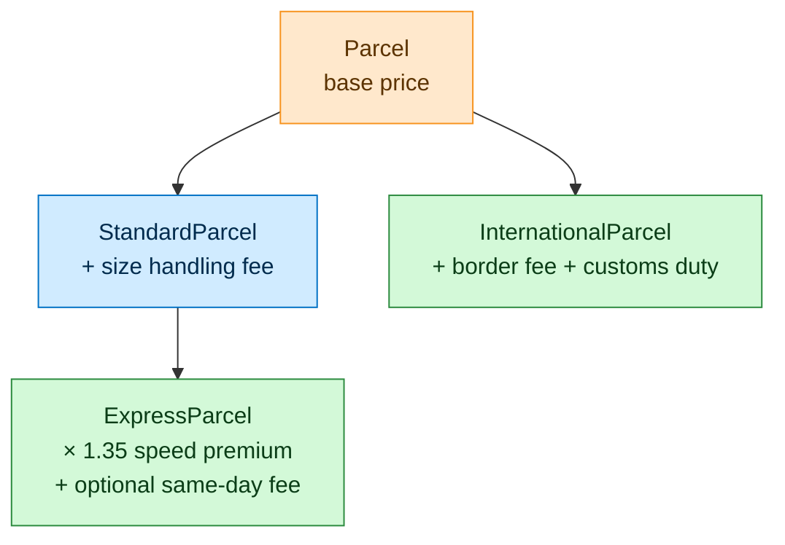
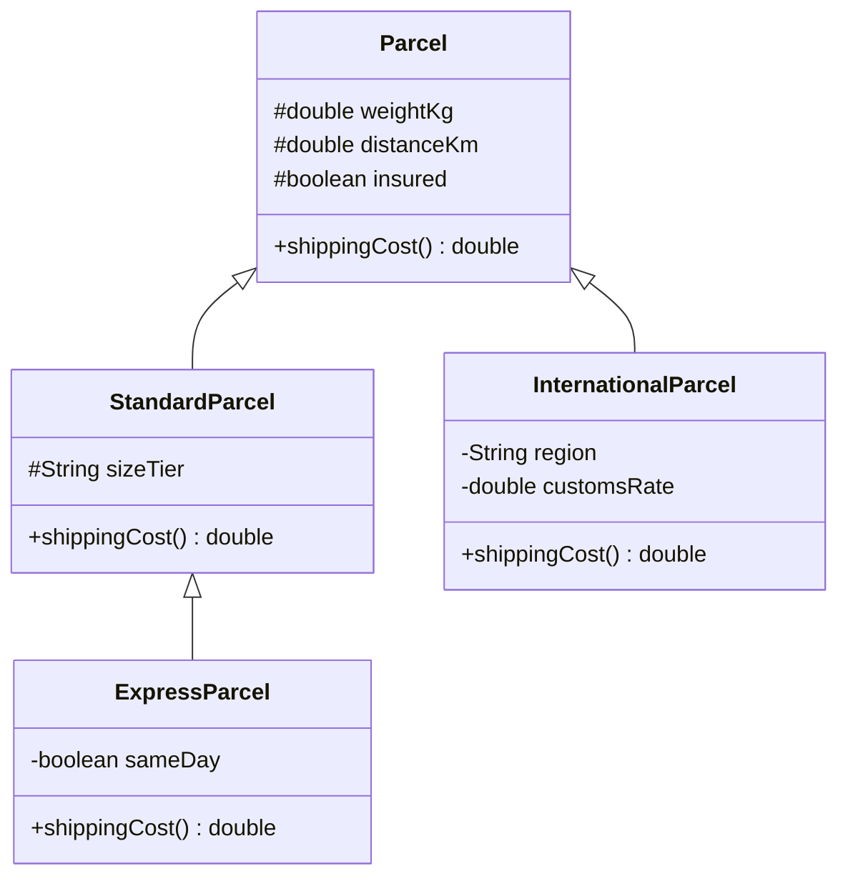

<div align="center">

# Delivery Cost Estimator

### Calculates standard, express and international shipping prices using an inheritance-based Java class design


</div>

---

## Overview

Every delivery company prices parcels differently depending on how fast and how far they're going. This project models that in Java: you create a parcel with its weight, distance and options, and it works out what the shipment should cost.

There are three delivery types: **standard**, **express** and **international**. Instead of one large method full of `if` statements, each type is its own class that **builds on the price of its parent class** and adds only its own extra charges. The result is short, readable pricing code where each rule lives in exactly one place.

---

## How It Works



Each class overrides `shippingCost()`, calls `super.shippingCost()` to get its parent's price, and then adds its own charges on top. An express parcel, for example, gets the full standard price first (including the size fee) and then applies its own premium.

---

## Pricing Rules

| Parcel type | How the price is calculated |
|:--|:--|
| **Parcel** (base) | $3.50 base fee + $1.20 per kg + $0.05 per km. Insurance adds the greater of $1.50 or 2% of the price. |
| **StandardParcel** | Base price + a size handling fee: **S** $0.75 · **M** $1.25 · **L** $1.75 |
| **ExpressParcel** | Standard price × **1.35** speed premium, plus a **$7.50** rush fee for same-day delivery |
| **InternationalParcel** | Base price + **$8.00** cross-border handling fee + customs duty (0–25% of the base price) |

---

## Class Design



| Class | Role |
|:--|:--|
| **`Parcel`** | Base class. Stores weight, distance and insurance, and calculates the base price. |
| **`StandardParcel`** | Adds a size tier (S, M or L) and its handling fee. |
| **`ExpressParcel`** | Extends `StandardParcel` with a speed premium and an optional same-day fee. |
| **`InternationalParcel`** | Adds a destination region, a border fee and customs duties. |
| **`Main`** | Creates one of each parcel type and prints its cost. |

> **Input validation:** invalid parcels are rejected as soon as they're created. Weight must be above 0, distance can't be negative, the size tier must be `S`, `M` or `L`, and the customs rate must be between 0 and 0.25. Anything else throws an `IllegalArgumentException`.

---

## Example Output

`Main` stores all three parcels in a single `Parcel[]` array and calls `shippingCost()` on each one. Java picks the right pricing rules for each parcel automatically, which is polymorphism in action.

| Parcel | Details | Cost |
|:--|:--|--:|
| Standard | 2.0 kg · 120 km · insured · size M | **$14.65** |
| Express | 1.0 kg · 40 km · size S · same-day | **$17.56** |
| International | 3.2 kg · 800 km · insured · EU · 12% customs | **$62.70** |

```text
  Cost: $14.65
  Cost: $17.56
  Cost: $62.70
```

<details>
<summary><b>How the express price is worked out</b></summary>

<br/>

| Step | Calculation | Running total |
|:--|:--|--:|
| Base price | $3.50 + (1.0 kg × $1.20) + (40 km × $0.05) | $6.70 |
| Size S handling fee | + $0.75 | $7.45 |
| Express premium | × 1.35 | $10.06 |
| Same-day rush fee | + $7.50 | **$17.56** |

</details>

---

## Project Layout

| File | Contents |
|:--|:--|
| `Parcel.java` | Base class and base pricing formula |
| `StandardParcel.java` | Size-tier handling fees |
| `ExpressParcel.java` | Express premium and same-day fee |
| `InternationalParcel.java` | Border fee and customs duties |
| `Main.java` | Demo that prices one parcel of each type |
| `build.xml`, `nbproject/` | NetBeans / Ant project files |

---

## Running It Yourself

**In NetBeans:** open the project folder and use **Run Project**.

**From the command line:**

```bash
javac -d out src/lab6/shipment/*.java
java -cp out lab6.shipment.Main
```

---

## Skills Demonstrated

- **Inheritance:** a three-level class hierarchy (`Parcel` → `StandardParcel` → `ExpressParcel`)
- **Method overriding:** each subclass extends its parent's pricing with `super.shippingCost()`
- **Polymorphism:** different parcel types handled through one shared `Parcel` type
- **Encapsulation:** `final` fields, with `protected` used only where subclasses need access
- **Defensive programming:** constructor validation with clear exception messages
- **Business logic modelling:** turning real-world pricing rules into clean, testable code

---

## Tools

| | |
|:--|:--|
| **Language** | Java 8+ |
| **IDE / Build** | Apache NetBeans (Ant) |
